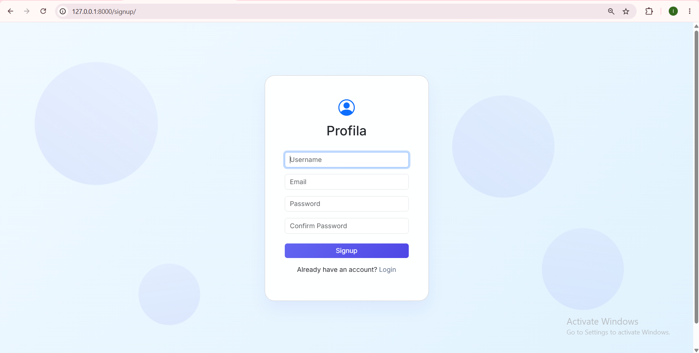
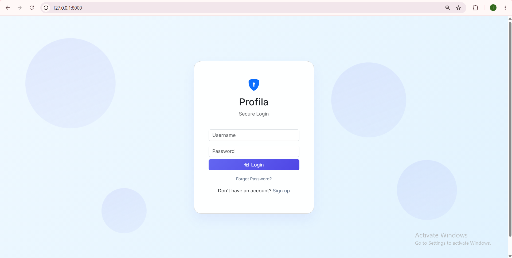
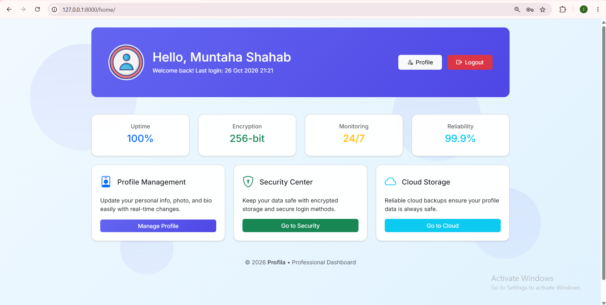
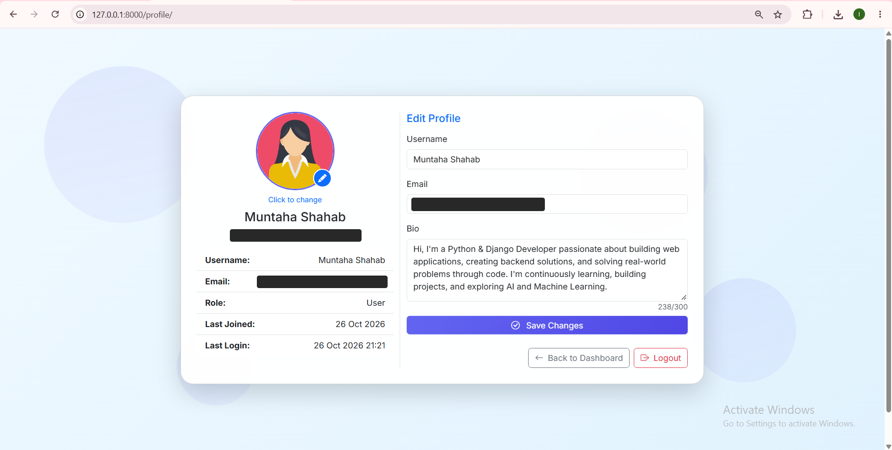

# Django Profile Management Portal

A web application I developed to practise building a complete user account workflow with Django, covering registration, account activation, authentication, dashboard access, and profile management.

The project uses Django's authentication features, SQLite for data storage, and Pillow for profile image handling. I also moved sensitive configuration into environment variables to keep credentials separate from the source code.

## Features

- **User Registration:** Create a new account through the signup page.
- **Account Activation:** Dedicated page for the account activation flow.
- **User Authentication:** Log in and log out of an account.
- **Dashboard:** Access the home dashboard after logging in.
- **Profile Management:** View profile information on a dedicated page.
- **Profile Pictures:** Handle profile images using Pillow.
- **Email Configuration:** Configure SMTP email settings through environment variables.

## Tech Stack

| Technology | Purpose |
|---|---|
| Python 3.12 | Programming language |
| Django 6.0.9 | Web framework |
| SQLite | Database |
| Pillow | Image processing |
| python-dotenv | Environment variable management |
| HTML and Django Templates | User interface |

## Screenshots

### 1. Signup Page



### 2. Login Page



### 3. Dashboard



### 4. Profile Page



## Project Structure

```text
django-profile-management-portal/
├── .gitignore
├── README.md
├── docs/
│   └── screenshots/
│       ├── signup.png
│       ├── login.png
│       ├── dashboard.png
│       └── profile.png
└── mysite/
    ├── accounts/
    │   ├── migrations/
    │   ├── admin.py
    │   ├── apps.py
    │   ├── models.py
    │   ├── tests.py
    │   ├── urls.py
    │   └── views.py
    ├── media/
    ├── mysite/
    │   ├── settings.py
    │   ├── urls.py
    │   ├── asgi.py
    │   └── wsgi.py
    ├── templates/
    ├── manage.py
    └── requirements.txt
```

## Getting Started

### Prerequisites

- Python 3.12
- pip
- Git

### 1. Clone the repository

Replace `YOUR-USERNAME` with your GitHub username after creating the repository.

```bash
git clone https://github.com/YOUR-USERNAME/django-profile-management-portal.git
cd django-profile-management-portal
```

### 2. Create a virtual environment

On Windows PowerShell:

```powershell
py -3.12 -m venv .venv
.\.venv\Scripts\Activate.ps1
```

### 3. Install dependencies

```powershell
python -m pip install -r .\mysite\requirements.txt
```

### 4. Configure environment variables

Create a `.env` file inside the `mysite` directory, next to `manage.py`.

Add your own configuration:

```dotenv
SECRET_KEY=your-new-secret-key
DEBUG=True
ALLOWED_HOSTS=127.0.0.1,localhost

EMAIL_HOST=smtp.gmail.com
EMAIL_PORT=587
EMAIL_USE_TLS=True
EMAIL_HOST_USER=your-email@example.com
EMAIL_HOST_PASSWORD=your-email-app-password
```

Use a newly generated Django secret key and your own email credentials. Never commit `.env` or real credentials to GitHub.

### 5. Apply database migrations

```powershell
python .\mysite\manage.py migrate
```

### 6. Run the development server

```powershell
python .\mysite\manage.py runserver
```

Open [http://127.0.0.1:8000/](http://127.0.0.1:8000/) in your browser.

## Development Checks

Check the Django configuration:

```powershell
python .\mysite\manage.py check
```

Check whether model changes require new migrations:

```powershell
python .\mysite\manage.py makemigrations --check --dry-run
```

Run the account app's tests:

```powershell
python .\mysite\manage.py test accounts
```

## Notes

- SQLite is configured as the default database.
- Uploaded profile images are handled through Django's media configuration.
- Email delivery requires valid SMTP credentials.
- The project is configured for local development and requires additional configuration before production deployment.
- Automated tests can be added to cover registration, login, logout, and profile management.

## Future Improvements

- Add automated tests for account workflows.
- Improve form validation and error handling.
- Add production deployment configuration.
- Expand profile editing functionality where needed.

---

Developed as a hands-on project to strengthen my understanding of Django, authentication workflows, database-backed applications, file uploads, and secure configuration management.
